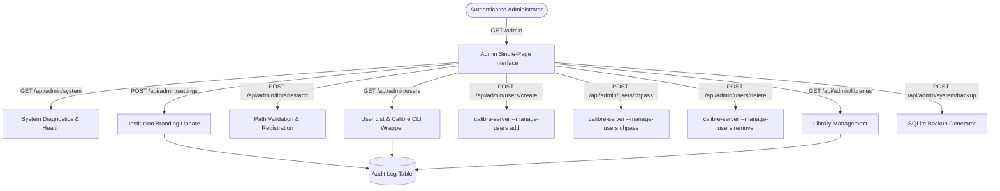

# CALIBRE INSTITUTIONAL — PHASE 4: INSTITUTIONAL ADMINISTRATION

**Document Reference:** `docs/phase4-administration.md`  
**System Version:** Calibre Institutional v0.4.0  
**Status:** Implemented, Tested, and Verified  
**Date:** October 2026  

---

## 1. Executive Summary

The Institutional Administration Portal (`/admin`) provides authorized institutional librarians and IT administrators with a centralized, browser-based management interface. Built to run over local campus networks and Wi-Fi, it allows administrative staff to manage branding, connect multiple Calibre libraries, provision and revoke patron accounts, inspect system diagnostics, and review audit trails without needing direct command-line access or modifying Python source files.

All administrative endpoints enforce strict server-side role verification (`Administrator`), origin-based CSRF defenses, and transaction isolation.

---

## 2. Administration Portal Architecture

---

## 3. Functional Modules

### 3.1 Executive Dashboard
Provides instantaneous visibility into the health and operational status of the digital library:
- **Calibre Core Backend:** Confirms loopback connectivity to `127.0.0.1:8088` and displays engine version (`v9.17.0`).
- **Configuration Store:** Reports SQLite schema version (`v1`) and active database path outside the source checkout.
- **Active Collections:** Count and status of connected Calibre repositories.
- **Registered Patrons:** Total provisioned patron accounts in the user database.
- **Institution Profile Card:** Displays active institution name, abbreviation, contact info, and branding colors.

### 3.2 Institution Identity & Branding Management
Administrators can update institutional identity dynamically:
- Fields: Institution Full Name, Short Name / Seal Abbreviation, Library Title, Discipline Subtitle, Helpdesk Email, Phone, and Interface Language.
- **Dynamic Propagation:** Changes are stored in `institutional_config.sqlite` and immediately reflected across:
  1. The public portal landing page (`/`).
  2. The institutional header, logo seal, and footer.
  3. The login modal prompts and helpdesk notes.
  4. The persistent navigation bar injected into the proxied Calibre reader UI (`/calibre/`).
- **Zero Restart Requirement:** Brand updates apply immediately to subsequent HTTP requests without restarting Calibre or the gateway.

### 3.3 Multi-Library Management
Allows managing multiple Calibre book repositories connected to the institutional gateway:
- **Library List:** Displays friendly display name, filesystem path, active status badge, default library indicator, and book count.
- **Path Validation:** Every proposed library addition is validated via `ConfigManager.validate_library_path()` to ensure `metadata.db` exists and is readable, while rejecting system roots (`C:\`, `C:\Windows`, `C:\Program Files`).
- **Non-Destructive Operations:**
  - *Toggle Active Status:* Disabling a library conceals it from patron search without deleting or modifying any book files.
  - *Set Default:* Designates the primary collection loaded on patron login.
  - *Disconnect Library:* Unregisters the library from the institutional catalog while preserving the original Calibre directory entirely intact.

### 3.4 Official Calibre User Administration
Calibre user credentials and authentication policies are managed strictly through official interfaces:
- **No Raw SQL Writes:** To prevent database corruption and preserve Calibre cryptographic schemes, user creation, password changes, read-only permission toggling, and account deletions are executed through `calibre-server.exe --manage-users`.
- **Institutional Roles:** Users are categorized into:
  - `Administrator`: Full access to the administration portal (`/admin`) and configuration APIs.
  - `Student` / `Faculty` / `Patron`: Catalog browsing, search, and reading access only; access to `/admin` is strictly blocked with `403 Forbidden`.
- **Read-Only Enforcement:** Permissions can be toggled per patron between Read-Only (viewing/reading only) and Read-Write (uploading/editing if permitted).
- **Self-Deletion Guard:** The system strictly prevents an authenticated administrator from deleting their own active account, preventing accidental institutional lockout.

### 3.5 System Diagnostics & Reliable Backups
- **Host & Network Diagnostics:** Displays LAN endpoint address (`192.168.0.107:8085`), loopback proxy target (`127.0.0.1:8088`), host operating system (`Windows NT 10.0`), Python runtime (`3.14.0`), and memory usage.
- **Transactional Backups:** Administrators can trigger on-demand backups of the configuration database via `POST /api/admin/system/backup`. Backups are saved with timestamped filenames (`institutional_config_YYYYMMDD_HHMMSS.sqlite.bak`) in a dedicated `backups/` directory.

### 3.6 Audit Trail Logging
Every administrative mutation is recorded immutably in the `audit_logs` table:
- **Captured Attributes:** Timestamp (ISO-8601 UTC), Actor username, Action identifier (`UPDATE_INSTITUTION_SETTINGS`, `ADD_LIBRARY`, `CREATE_USER`, `DELETE_USER`, `BACKUP_DATABASE`), Client IP address, and JSON-encoded change details.
- **Tamper Evidence:** Audit logs are viewable directly from the admin interface and cannot be altered or deleted through the web UI.

---

## 4. Administrative API Endpoints

| Endpoint | Method | Required Role | Description |
| :--- | :---: | :---: | :--- |
| `/api/admin/system` | `GET` | `Administrator` | Returns server diagnostics, host network details, and library/patron statistics. |
| `/api/admin/settings` | `POST` | `Administrator` | Transactionally updates institutional name, seal abbreviation, and contact details. |
| `/api/admin/libraries` | `GET` | `Administrator` | Returns all registered Calibre libraries with active/default states. |
| `/api/admin/libraries/add` | `POST` | `Administrator` | Validates and connects a new Calibre library. |
| `/api/admin/libraries/default` | `POST` | `Administrator` | Sets the designated primary default library. |
| `/api/admin/libraries/toggle` | `POST` | `Administrator` | Toggles active/inactive visibility for a library non-destructively. |
| `/api/admin/libraries/remove` | `POST` | `Administrator` | Disconnects a library from gateway catalog without deleting files. |
| `/api/admin/users` | `GET` | `Administrator` | Lists all Calibre users enriched with institutional role metadata. |
| `/api/admin/users/create` | `POST` | `Administrator` | Creates a new user via `calibre-server.exe --manage-users add`. |
| `/api/admin/users/chpass` | `POST` | `Administrator` | Updates patron password via `calibre-server.exe --manage-users chpass`. |
| `/api/admin/users/toggle-readonly` | `POST` | `Administrator` | Updates patron read-only restriction via `calibre-server.exe --manage-users readonly`. |
| `/api/admin/users/delete` | `POST` | `Administrator` | Deletes a user via `calibre-server.exe --manage-users remove`. |
| `/api/admin/system/backup` | `POST` | `Administrator` | Creates a timestamped SQLite database backup. |
| `/api/admin/audit` | `GET` | `Administrator` | Retrieves the immutable administrative audit trail. |

---

## 5. Visual Proof & Screenshots

The administration portal workflows were verified and recorded using Chrome DevTools Protocol (CDP) at `1440x900` resolution:

### 5.1 Executive Dashboard

*Figure 4.2: Administrator Executive Dashboard showing system health, Calibre backend connectivity, configuration schema version, and institution overview.*

### 5.2 Multi-Library Management

*Figure 4.3: Connected Calibre Libraries view showing path verification, active status badges, default collection tags, and non-destructive action triggers.*

### 5.3 User Administration

*Figure 4.4: Calibre User Management view displaying provisioned accounts, institutional role badges, read-only permissions, and credential management.*

---

## 6. Verification Status

- Automated test `test_03_admin_portal_access_control`: **PASSED** (unauthenticated and non-admin patrons strictly rejected with 403).
- Automated test `test_04_institution_settings_update_and_branding`: **PASSED** (verifies atomic updates and portal branding reflection).
- Automated test `test_05_library_management_crud`: **PASSED** (verifies adding, default setting, toggling, and non-destructive removal).
- Automated test `test_06_calibre_user_administration_lifecycle`: **PASSED** (verifies add, chpass, login, readonly toggle, and deletion via official CLI).
- Automated test `test_07_csrf_protection_on_admin_actions`: **PASSED** (cross-origin POST requests rejected).
- Automated test `test_08_system_backup_and_audit_trail`: **PASSED** (backup generation and audit log persistence verified).
- Visual browser inspection: **PASSED** (CDP screenshot verification confirmed).
