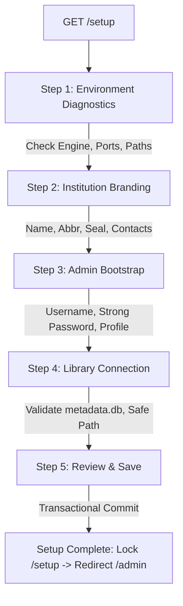

# CALIBRE INSTITUTIONAL — PHASE 4: FIRST-TIME SETUP WIZARD

**Document Reference:** `docs/phase4-setup-wizard.md`  
**System Version:** Calibre Institutional v0.4.0  
**Status:** Implemented, Tested, and Verified  
**Date:** October 2026  

---

## 1. Executive Summary

The First-Time Setup Wizard transforms the Calibre Institutional prototype into a self-configurable, production-ready product. In enterprise and institutional environments (universities, colleges, polytechnics, public administration institutes), IT installations are frequently executed by administrative personnel who require a clear graphical workflow rather than manual configuration file edits or command-line scripting.

The setup wizard is accessible at `/setup` and guides the administrator through five sequential steps:
1. **Welcome & Environment Pre-flight Check**
2. **Institution Identity & Branding**
3. **Administrator Bootstrap**
4. **Library Connection & Validation**
5. **Configuration Review & Transactional Activation**

---

## 2. Five-Step Wizard Architecture

### Step 1: Welcome & Environment Pre-flight Check
Before allowing configuration entry, the wizard executes a comprehensive automated health check against the hosting Windows host:
- **Calibre Core Installation:** Validates existence of `calibre-server.exe` and `calibredb.exe` under `C:\Program Files\Calibre2\`.
- **Engine Version:** Probes upstream version (`v9.17.0`) via the isolated loopback interface.
- **Network Isolation:** Verifies backend Content Server is isolated on loopback (`127.0.0.1:8088`) and the Institutional Gateway is ready on `0.0.0.0:8085`.
- **Configuration Storage:** Verifies access to the Windows Application Data storage directory (`%LOCALAPPDATA%\CalibreInstitutional\config` or dev override).
- **Filesystem Permissions:** Validates read/write access to data directories without silently modifying OS system files or firewall rules.

### Step 2: Institution Identity & Branding
Captures foundational identity metadata that dynamically themes the portal, login modals, and the injected Calibre navigation bar:
- **Institution Full Legal Name:** e.g., *"National Institute of Public Administration"*
- **Institutional Abbreviation / Monogram:** e.g., *"NIPA"* (rendered inside the top-bar brand seal)
- **Library Collection Title:** e.g., *"Dr. Kenneth Kaunda Memorial Digital Library"*
- **Library Subtitle / Motto:** e.g., *"Excellence in Leadership, Governance and Public Policy"*
- **Official Contact Email & Telephone:** Displayed on public footer and login helpdesk prompts.
- **Default System Language:** ISO-639-1 code (`en`).

### Step 3: Administrator Bootstrap
Establishes the primary institutional administrator without hardcoded credentials or defaults:
- **No Default Passwords:** The system enforces entering an explicit administrative password (minimum 8 characters with upper, lower, and digit requirements).
- **Account Binding:** Creates an authenticated account inside the Calibre `server-users.sqlite` database using the official `calibre-server.exe --manage-users` CLI wrapper, granting `[libraries: "*", write: true]` permissions.
- **Institutional Role Mapping:** Stores profile metadata (`role = "Administrator"`, `display_name = "Chief Archivist"`, `department = "Library Services"`) in the SQLite configuration store.

### Step 4: Library Connection & Safety Enforcement
Allows administrators to connect existing Calibre libraries or initialize an empty repository:
- **Path Validation:** Requires input of the absolute folder path containing `metadata.db`.
- **System Protection Guards:** Rejects root volumes (`C:\`, `D:\`), Windows system folders (`C:\Windows`), and binary program directories (`C:\Program Files`, `C:\Program Files (x86)`).
- **Non-Destructive Guarantee:** Enforces that `metadata.db` is strictly opened in read-only validation mode; no records or book files are altered, overwritten, or moved.
- **Display Friendly Name:** Maps internal folder paths to readable institutional names (e.g., *"Primary Academic Collection"*).

### Step 5: Review & Transactional Activation
Presents a complete summary of configured values. Upon administrator confirmation:
- The configuration payload is sent via `POST /api/setup/complete`.
- `ConfigManager.update_institution_settings()` updates institutional metadata in a SQLite transaction.
- `ConfigManager.add_library()` registers the validated library path and marks it as default.
- `ConfigManager.complete_setup()` flags `setup_completed = 1` and records an audit log entry.
- The wizard permanently locks `/setup` from repeated unauthenticated execution and presents the Administrator Dashboard.

---

## 3. Setup API Endpoints

| Endpoint | Method | Authorization | Description |
| :--- | :---: | :---: | :--- |
| `/api/setup/status` | `GET` | Public / Localhost | Returns pre-flight diagnostics, Calibre engine status, and setup completion flag. |
| `/api/setup/validate-path` | `POST` | Public (Setup Mode) | Validates whether a proposed filesystem path contains a valid `metadata.db` and is not a protected OS path. |
| `/api/setup/complete` | `POST` | Public (Setup Mode) | Transactionally commits the bootstrap administrator, institution identity, and initial library. |

---

## 4. Security & Hardening Safeguards

1. **Setup Wizard Locking (`403 Forbidden` / State Lock):** Once setup has been completed, any subsequent invocation of `/api/setup/complete` or access to `/setup` is locked. Re-running setup requires administrative authentication or explicit command-line intervention.
2. **CSRF Protection:** Origin and Referer validation headers are enforced on all setup POST endpoints.
3. **No Credential Exposure:** Bootstrap passwords are never echoed in HTTP responses, logs, or diagnostic payloads.
4. **Path Traversal Protection:** All submitted library paths are resolved with `os.path.realpath()` and checked against forbidden directory blacklists.

---

## 5. Visual Proof & Screenshots

The browser journey was verified using Chrome DevTools Protocol (CDP) at `1440x900` resolution:

*Figure 4.1: First-Time Setup Wizard Step 1 showing automated environment diagnostics, Calibre engine verification, and system status.*

---

## 6. Verification Status

- Automated test `test_01_setup_status_preflight`: **PASSED** (verifies status JSON structure, engine version, and storage path).
- Automated test `test_02_library_path_validation`: **PASSED** (verifies rejection of system roots and acceptance of valid `metadata.db`).
- Automated test `test_09_setup_wizard_completion_locking`: **PASSED** (verifies setup completion locks subsequent calls).
- Visual browser inspection: **PASSED** (verified via headless Chrome CDP capture).
